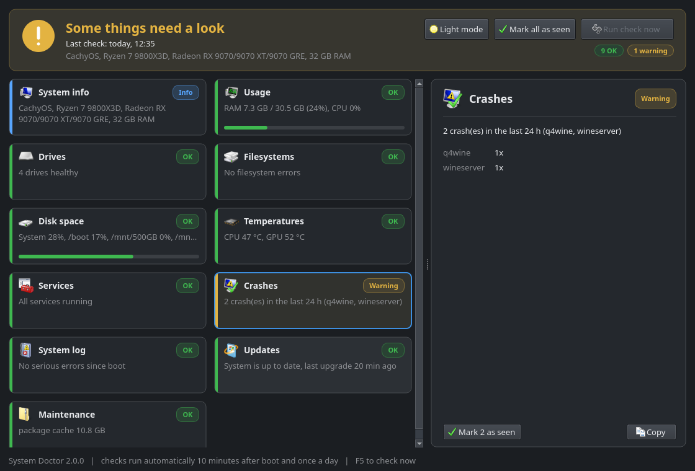
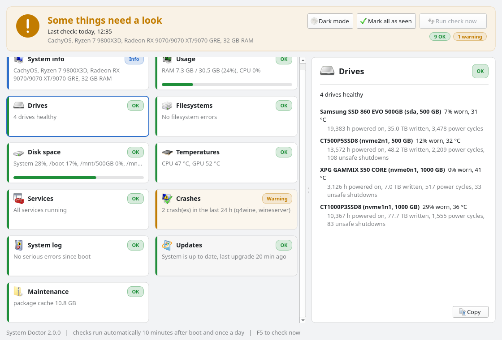

<p align="center"></p>

<h1 align="center">System Doctor</h1>

<p align="center">A daily health check for Arch-based Linux with a clean dashboard.<br>
It notifies you only when something <b>new</b> goes wrong.</p>



<details>
<summary>Light theme</summary>


</details>

## Features

- One card per area, click it for all details
- Dark and light theme (`Ctrl+T`)
- Mark known warnings as seen, they only come back when something new happens
- Runs by itself 10 minutes after boot and once a day
- Only reads your system, never changes anything

## What it checks

| Area | Details |
|---|---|
| **System info** | OS, kernel, desktop, CPU, GPU, RAM modules, mainboard, BIOS |
| **Usage** | RAM, swap, CPU and the hungriest programs |
| **Drives** | SMART health, wear, temperature, hours, TB written |
| **Filesystems** | Btrfs error counters |
| **Disk space** | Fill level of every drive |
| **Temperatures** | CPU, GPU (hotspot, VRAM, fan, power), RAM, Wi-Fi, USB |
| **Services** | Failed system and user services |
| **Crashes** | Programs that crashed in the last 24 hours |
| **System log** | Hardware errors, GPU resets, disk I/O errors, out-of-memory kills |
| **Updates** | Pending updates and the last full upgrade |
| **Maintenance** | `.pacnew` files, package cache, orphaned packages |

## Install

For Arch-based systems (Arch, CachyOS, EndeavourOS, Manjaro, ...). Run the steps one by one in a terminal.

**1. Install git** (if you don't have it)
```bash
sudo pacman -S --needed git
```

**2. Download**
```bash
git clone https://github.com/Flezzonkeys/system-doctor.git
```

**3. Go into the folder**
```bash
cd system-doctor
```

**4. Install** (missing packages are installed automatically after asking)
```bash
sudo bash install.sh
```

Done. Open *System Doctor* from your app menu.

## Update

```bash
cd system-doctor
```
```bash
git pull
```
```bash
sudo bash install.sh
```

## Uninstall

**1. Go into the folder** (if you deleted it, download it again with step 2 of Install)
```bash
cd system-doctor
```

**2. Uninstall**
```bash
sudo bash uninstall.sh
```

**3. Optional: remove your settings and the downloaded folder**
```bash
rm -rf ~/.config/system-doctor
```
```bash
cd .. && rm -rf system-doctor
```

## Terminal commands

| Command | What it does |
|---|---|
| `doctor` | Show the latest report |
| `doctor now` | Run a new check |
| `doctor all` | Show all details |
| `doctor clear` | Mark current warnings as seen |
| `doctor gui` | Open the window |

## License

MIT, see [LICENSE](LICENSE).
